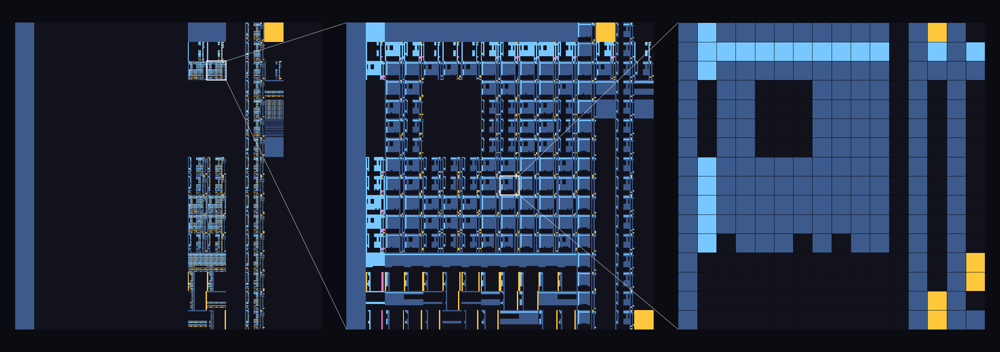

# lkm — Levin, Kolmogorov, metabiología y autorreferencia

Implementación en C de la búsqueda universal de Levin, cotas de complejidad de
Kolmogorov, metabiología (evolución de programas al estilo de Chaitin) y
**autorreferencia** (quines, autoinspección) sobre una máquina virtual de pila
de 16 opcodes.


## Compilar y ejecutar

```sh
make            # requiere gcc con OpenMP (gcc estándar en Linux)
./lkm           # todas las demos (~2-3 min)
./lkm quines 9  # una demo concreta; el número es la longitud máxima
make test       # búsqueda perezosa vs fuerza bruta, y quine manual
make figures    # figuras en figures/ (requiere numpy y matplotlib)
```

## Figuras

### Mapa de parada



Cada píxel es un programa de 6 símbolos (16^6 = 16 777 216 en total) y su
color indica cómo termina con un presupuesto de 256 pasos. Las columnas codifican los símbolos en posiciones pares (0, 2, 4) y las filas
los de posiciones impares (1, 3, 5), del más al menos significativo. Así, el
primer par de símbolos elige un bloque, el segundo un sub-bloque, etc.: fijar
un prefijo es hacer zoom.


## Máquina virtual

Un programa es una secuencia de **símbolos de 4 bits** (0–15). Un programa de L
símbolos ocupa exactamente 4L bits, de modo que los pesos 2^-|p| de Levin y
Solomonoff son 16^-L.

| sím. | op    | efecto                                   | sím. | op    | efecto                                  |
|------|-------|------------------------------------------|------|-------|-----------------------------------------|
| 0    | HALT  | para                                     | 8    | DEC   | tope − 1                                |
| 1    | OUT   | desapila y emite                         | 9    | PUSH0 | apila 0                                 |
| 2    | DUP   | duplica el tope                          | a    | PUSH1 | apila 1                                 |
| 3    | SWAP  | intercambia los dos de arriba            | b    | READ  | i := tope; tope := code[i]              |
| 4    | ADD   | a + b                                    | c    | LIT n | apila n (0–15)                          |
| 5    | SUB   | a − b                                    | d    | JMP d | pc := pc + d, d ∈ [−8, +7]              |
| 6    | MUL   | a · b                                    | e    | JZ d  | desapila; si 0, salta                   |
| 7    | INC   | tope + 1                                 | f    | JNZ d | desapila; si ≠ 0, salta                 |
